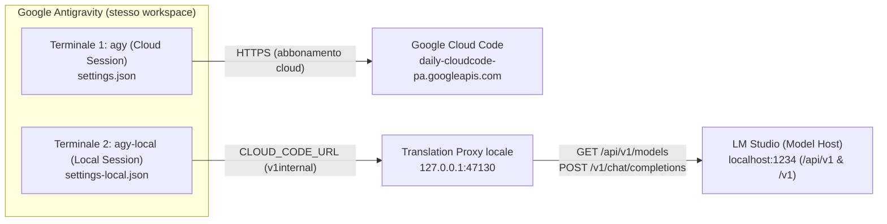

# agy-local

`agy-local` permette di utilizzare la CLI ufficiale di Google Antigravity (`agy`) su un terminale separato eseguendo l'inferenza sui modelli locali ospitati da **LM Studio** (`http://localhost:1234/v1`), in parallelo alle normali sessioni `agy` basate sull'abbonamento cloud.

Grazie a questa architettura puoi tenere aperti due terminali dentro Google Antigravity — uno con `agy` (cloud) e uno con `agy-local` (locale) — mantenendo sul terminale locale il **100% dei comandi slash** (`/model`, `/context`, `/clear`, `/compact`, `/help`), **tutti i tool nativi** (`read_file`, `edit_file`, `write_file`, `run_command`), **tutte le skill** e i **riferimenti `@file` del workspace**, a consumo zero di token dell'abbonamento.

---

## Indice

- [Caratteristiche principali](#caratteristiche-principali)
- [Architettura dell'applicazione](#architettura-dellapplicazione)
- [Manuale di installazione passo passo](#manuale-di-installazione-passo-passo)
- [Utilizzo su doppio terminale in Google Antigravity](#utilizzo-su-doppio-terminale-in-google-antigravity)
- [Gestione del carico con il modello ausiliario](#gestione-del-carico-con-il-modello-ausiliario)
- [Riferimento dei comandi CLI](#riferimento-dei-comandi-cli)
- [Documentazione correlata](#documentazione-correlata)

---

## Caratteristiche principali

- **Esperienza nativa completa di `agy`**: non è un wrapper limitato o una chat separata, ma esegue il binario ufficiale `agy` reindirizzandone il backend verso un proxy di traduzione locale.
- **Scoperta dinamica dei metadati da LM Studio**: interroga `GET http://localhost:1234/api/v1/models` (con fallback su `/api/v0/models` e `/v1/models`) per escludere i modelli di solo embedding, mappare la reale finestra di contesto (`max_context_length` $\rightarrow$ `/context`), il supporto immagini (`vision`), il supporto ragionamento (`reasoning` / `<think>`) e mostrare in `/model` quali modelli sono già caricati in memoria (`● ... [Loaded]`).
- **Isolamento totale tra sessione cloud e sessione locale**: il cambio di modello con `/model` dentro `agy-local` non sovrascrive mai il modello cloud salvato in `~/.gemini/antigravity-cli/settings.json`.
- **Sicurezza fail-closed e backup automatico del binario**: verifica ad ogni avvio che il binario `agy` supporti `CLOUD_CODE_URL` e ne mantiene una copia funzionante in `~/.gemini/agy-local/bin/agy-pinned`, impedendo qualsiasi consumo involontario di token cloud anche dopo futuri aggiornamenti di `agy`.
- **Dual-model routing e protezione anti-thrashing della VRAM**: consente di affiancare al modello principale un modello locale più leggero (es. Gemma 4 E4B) per i task secondari (titoli conversazione, `/compact`, commit message, sotto-agenti `flash_lite`), tornando automaticamente sul modello principale se LM Studio non ha abbastanza VRAM per mantenerli entrambi caricati.
- **Zero dipendenze esterne**: scritto interamente con la libreria standard di Python 3.

---

## Architettura dell'applicazione

Il binario ufficiale `agy` esegue localmente sulla macchina dell'utente l'interfaccia terminale (TUI), il Language Server integrato, i tool di modifica file/terminale e l'espansione delle skill, comunicando con l'esterno tramite il protocollo HTTP/SSE Cloud Code (`v1internal`).

`agy-local` sfrutta l'hook di configurazione `CLOUD_CODE_URL` del binario `agy` per instradare tutte le chiamate `v1internal` della sessione locale verso un **Translation Proxy** locale in ascolto su `127.0.0.1:47130`, lasciando completamente invariate le sessioni `agy` standard aperte negli altri terminali.



### Componenti e moduli (`src/agy_local/`)

| Modulo | Responsabilità architetturale |
| :--- | :--- |
| [`bin/agy-local`](bin/agy-local) | Punto di ingresso eseguibile installato tramite symlink in `~/.local/bin/agy-local`. |
| [`src/agy_local/cli.py`](src/agy_local/cli.py) | Gestisce i sottocomandi (`install`, `status`, `aux`, `logs`, `restart`, `stop`), avvia automaticamente in background il proxy di traduzione e lancia `agy` con `CLOUD_CODE_URL` e `--settings` isolati. |
| [`src/agy_local/safety.py`](src/agy_local/safety.py) | Esegue la verifica *fail-closed* dei simboli `CLOUD_CODE_URL` nel binario `agy` e gestisce il salvataggio e il fallback automatico sul binario `agy-pinned` in `~/.gemini/agy-local/bin/agy-pinned`. |
| [`src/agy_local/config.py`](src/agy_local/config.py) | Gestisce la persistenza in `~/.gemini/agy-local/config.json` e genera `~/.gemini/agy-local/settings-local.json` copiando `permissions`, `trustedWorkspaces` e `colorScheme` dal profilo cloud senza condividere il campo `model`. |
| [`src/agy_local/model_host.py`](src/agy_local/model_host.py) | Interroga le API di LM Studio (`/api/v1/models`, `/api/v0/models`, `/v1/models`), costruisce il catalogo `/v1internal:fetchAvailableModels` e implementa il `DualModelRouter` con rilevamento anti-thrashing della VRAM. |
| [`src/agy_local/translator.py`](src/agy_local/translator.py) | Traduce in modo bidirezionale richieste e flussi SSE tra il formato Gemini `v1internal` (`systemInstruction`, `contents`, `tools`, `thought`, `functionCall`, `functionResponse`) e il formato OpenAI `/v1/chat/completions`, normalizzando anche i percorsi relativi o `@file` passati dai modelli locali ai tool sul filesystem. |
| [`src/agy_local/proxy.py`](src/agy_local/proxy.py) | Server HTTP multi-thread (`ThreadingHTTPServer`) che risponde in locale a tutti gli endpoint di bootstrap e telemetria (`loadCodeAssist`, `retrieveUserQuotaSummary`, `listExperiments`, `countTokens`) e inoltra i flussi `streamGenerateContent` e `generateContent` a LM Studio con serializzazione per singolo modello durante il caricamento JIT. |

---

## Manuale di installazione passo passo

Per una guida estesa comprensiva di risoluzione dei problemi, consulta anche [`docs/installazione.md`](docs/installazione.md).

### 1. Verifica dei prerequisiti

Assicurati di avere:
- la CLI ufficiale `agy` installata e funzionante (`which agy`);
- `python3` (versione 3.10 o superiore);
- **LM Studio** avviato con il server locale attivo su `http://localhost:1234/v1` (scheda **Developer** $\rightarrow$ **Start server**).

### 2. Clonazione del repository da GitHub

```bash
git clone https://github.com/luciano-vitale/agy-local.git
cd agy-local
```

### 3. Installazione rapida

Esegui il comando di installazione integrato:

```bash
./bin/agy-local install
```

Il comando crea il collegamento simbolico in `~/.local/bin/agy-local`, salva la copia di sicurezza `agy-pinned`, inizializza le impostazioni isolate e verifica la connessione a LM Studio.

*(In alternativa puoi creare manualmente il symlink con `chmod +x bin/agy-local && mkdir -p ~/.local/bin && ln -sf "$(pwd)/bin/agy-local" ~/.local/bin/agy-local`).*

Se `~/.local/bin` non è ancora nel tuo `PATH`, aggiungilo a `~/.zshrc`:

```bash
echo 'export PATH="$HOME/.local/bin:$PATH"' >> ~/.zshrc
source ~/.zshrc
```

### 4. Verifica dello stato

```bash
agy-local status
```

---

## Utilizzo su doppio terminale in Google Antigravity

1. **Apri Google Antigravity** sul tuo progetto.
2. **Terminale 1 (modelli in abbonamento cloud)**:
   - apri un terminale integrato ed esegui:
     ```bash
     agy
     ```
   - digita `/model` e scegli un modello del tuo abbonamento (es. `Gemini 4 Argon (Medium)`).
3. **Terminale 2 (modelli locali di LM Studio)**:
   - apri un secondo terminale integrato separato ed esegui:
     ```bash
     agy-local
     ```
   - digita `/model`: visualizzerai tutti i tuoi modelli LLM locali di LM Studio (i modelli già presenti in RAM/VRAM sono indicati con `● ... [Loaded]`);
   - seleziona il modello locale con cui lavorare e usa normalmente `/context`, `/clear`, `/compact`, `@file`, tool e skill.

---

## Gestione del carico con il modello ausiliario

Puoi configurare un secondo modello locale più leggero (**Auxiliary Local Model**, ad esempio `gemma-4-e4b-it-mlx@4bit`) a cui delegare automaticamente le chiamate secondarie di `agy` (generazione del titolo della conversazione, `/compact`, messaggi di commit e sotto-agenti `flash_lite`):

```bash
# Imposta il modello ausiliario leggero
agy-local aux gemma-4-e4b-it-mlx@4bit

# Mostra la configurazione attuale e i modelli disponibili
agy-local aux

# Disattiva il modello ausiliario (usa solo il modello principale scelto con /model)
agy-local aux off
```

---

## Riferimento dei comandi CLI

| Comando | Descrizione |
| :--- | :--- |
| `agy-local` | Avvia la sessione interattiva `agy` collegata a LM Studio (avviando il proxy se necessario). |
| `agy-local --model <id>` | Avvia `agy-local` impostando direttamente il modello locale primario indicato. |
| `agy-local models` | Elenca nel terminale tutti i modelli LLM locali esposti da LM Studio e il loro stato `[Loaded]`. |
| `agy-local status` | Mostra lo stato del binario `agy`, del backup `agy-pinned`, del proxy, di LM Studio e della VRAM. |
| `agy-local aux [id\|off]` | Mostra, imposta o disattiva il modello locale ausiliario per i carichi secondari. |
| `agy-local logs [-n N]` | Mostra le ultime `N` righe del file di log del proxy (`~/.gemini/agy-local/proxy.log`). |
| `agy-local restart` | Riavvia il demone in background del proxy di traduzione. |
| `agy-local stop` | Arresta il demone in background del proxy di traduzione. |
| `agy-local install` | Crea il symlink in `~/.local/bin/agy-local`, verifica il `PATH` e aggiorna `agy-pinned`. |

---

## Documentazione correlata

- [Manuale di installazione e utilizzo passo passo](docs/installazione.md)
- [GLOSSARY.md](GLOSSARY.md) — glossario dei termini di dominio del progetto
- [ADR 0001](docs/adr/0001-cloudcode-translation-proxy.md) — decisione architetturale sull'uso di `CLOUD_CODE_URL` e del Translation Proxy
